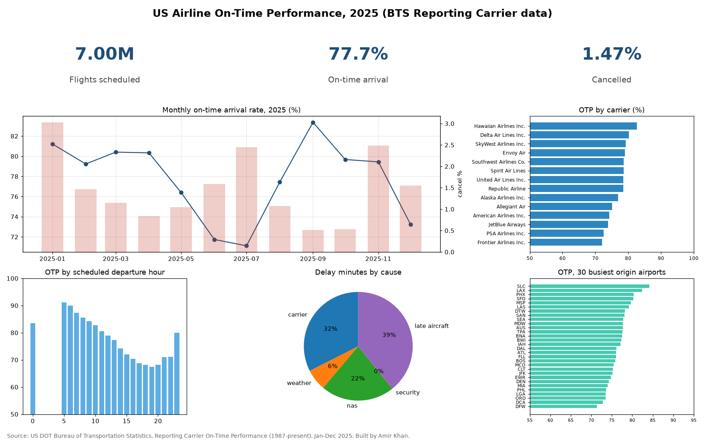

# US Airline On-Time Performance: Snowflake-dialect SQL + Tableau-ready extract

Analysis of **7,001,619 scheduled US domestic flights in 2025** from the US DOT Bureau of Transportation Statistics (BTS). Models are written in **Snowflake SQL**, transpiled with `sqlglot` and executed locally on **DuckDB**, and the output is a Tableau-ready extract with documented calculated fields.



## Business problem
An airline network-planning or airport-operations team wants to know where and when on-time performance (OTP) breaks down, and what drives delay minutes:
1. What share of 2025 flights arrived on time, and how many were cancelled?
2. Which carriers and which of the 30 busiest airports perform best and worst?
3. How does OTP change by month and by scheduled departure hour?
4. Which delay causes (carrier, late aircraft, NAS, weather, security) account for the most delay minutes?

## Key findings (Jan to Dec 2025)
| Metric | Value |
|---|---|
| Scheduled flights | 7,001,619 |
| On-time arrival rate (operated flights, arrival delay < 15 min) | 77.7% |
| Cancelled | 102,876 (1.47%) |
| Best / worst carrier (of 14) | Hawaiian Airlines Inc. 82.7% / Frontier Airlines Inc. 72.1% |
| Best / worst month | 2025-09 83.4% / 2025-07 71.1% |
| Best / worst of 30 busiest origin airports | SLC 84.2% / DFW 71.3% |
| OTP for 06:00 departures vs worst hour (19:00) | 89.9% vs 67.4% |
| Share of delay minutes: late aircraft / carrier / NAS / weather | 39.2% / 32.5% / 21.9% / 6.4% |

So what: late-arriving aircraft is the largest single cause of delay minutes, and OTP falls steadily through the day. That pattern is consistent with delays propagating through aircraft rotations, so early-day buffers matter more than late-day ones. These are descriptive correlations, not causal estimates.

## Data
- **BTS Reporting Carrier On-Time Performance (1987-present)**, monthly files Jan to Dec 2025: <https://www.transtats.bts.gov/DL_SelectFields.aspx?gnoyr_VQ=FGJ&QO_fu146_anzr=b0-gvzr>. Direct files: `https://transtats.bts.gov/PREZIP/On_Time_Reporting_Carrier_On_Time_Performance_1987_present_2025_<m>.zip`. US government work, public domain.
- **BTS carrier lookup (L_UNIQUE_CARRIERS)**: <https://transtats.bts.gov/Download_Lookup.asp?Y11x72=Y_haVdhR_PNeeVRef>.
- `ingest/download.py` records URL, size and SHA-256 for every file in `data/manifest.json`. Raw files (about 350 MB zipped) are not committed.

## Method
```
BTS zip -> Parquet (17 columns) -> models/snowflake/*.sql (Snowflake dialect)
        -> sqlglot transpile -> DuckDB tables -> kpis.json, charts, Tableau extract, README
```
- `models/snowflake/`: staging, carrier dimension, carrier-month fact, airport fact (QUALIFY + RANK window), hour-of-day fact, Tableau extract. They use Snowflake functions (`IFF`, `DIV0`, `TRY_CAST`, `QUALIFY`, `DATE_TRUNC`).
- `snowflake/00_setup.sql`: the stage / `INFER_SCHEMA` / `COPY INTO` script you would run on Snowflake.
- `tableau/ontime_extract_2025.csv` (month x carrier x airport for the 30 busiest airports) plus `tableau/CALCULATED_FIELDS.md` with the Tableau calculated fields to rebuild the dashboard.
- Every number in this README is generated from `reports/kpis.json`, and a test fails if they drift apart.

## Honest scope
- **No Snowflake account was used.** The SQL is written in Snowflake dialect and checked by transpiling it with sqlglot and running it on DuckDB. `snowflake/00_setup.sql` has not been executed against a live Snowflake instance.
- **No Tableau Public workbook is published.** The repo ships a Tableau-ready extract and calculated-field definitions. The dashboard image was rendered with matplotlib.
- OTP is defined as BTS does (ArrDel15 = 0 among flights that were neither cancelled nor diverted). Delay-cause minutes are only reported for flights 15 or more minutes late.

## Skills shown
SQL (CTEs, window functions, QUALIFY), Snowflake SQL dialect, SQL transpilation (sqlglot), DuckDB, dimensional modelling, Python (pandas-free pipeline, matplotlib), data-pipeline reproducibility (manifest + checksums), Tableau data preparation, pytest, GitHub Actions CI.

## How to run
```bash
python -m venv .venv && . .venv/bin/activate
pip install -r requirements.txt
python ingest/download.py   # ~350 MB from transtats.bts.gov
python run.py               # builds warehouse, kpis.json, charts, extract, README
python -m pytest -q
```
CI runs the unit tests (fixture data, transpile checks, README drift). The full-data tests skip when `data/` is absent.

## Author
Amir Khan, github.com/amirator
